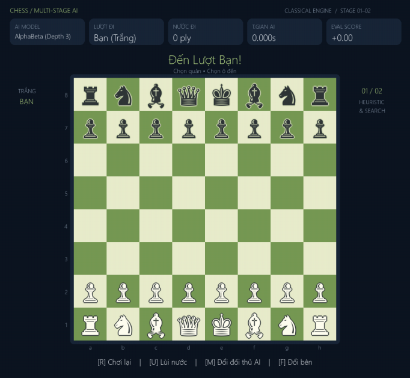

# Chess Multi-Stage AI — 7 giai đoạn theo mô hình AlphaGo & AlphaZero

Bài tập lớn môn **Trí tuệ Nhân tạo Nâng cao**. Dự án phát triển AI cờ vua qua bảy thế hệ: luật heuristic → tìm kiếm cây → MCTS → học giám sát → reinforcement learning → AlphaGo MCTS → AlphaZero.

Kiến trúc kế thừa cách tổ chức của `connect4-multi-stage-ai`, chuyển luật chơi sang `python-chess`. **Core, GUI/CLI, Arena và Stage 1–2 của Thắng đã hoàn thành**; Stage 3–7 là skeleton bàn giao, chưa được đăng ký làm bot có thể chơi.



## 1. Phân công & tiến độ

| Thành viên | Vai trò & giai đoạn phụ trách | Thư mục phụ trách | Trạng thái |
| :--- | :--- | :--- | :---: |
| **Thắng** | **Core Base**: kiến trúc, board, encoder<br>**GUI & CLI**: Pygame Dashboard, Terminal<br>**Arena**: 1v1, round-robin, Elo<br>**Stage 1**: Think1, Think2, Think3<br>**Stage 2**: Minimax, Alpha-Beta, Quiescence<br>Kiểm thử, tài liệu tích hợp | `games/`<br>`arena/`<br>`agents/stage1_heuristics/`<br>`agents/stage2_tree_search/`<br>`tests/`, `main.py` | ✅ **Đã triển khai; 61 test đạt** |
| **Thi** | **Stage 3**: Pure MCTS — UCB1, Expansion, Rollout, Backprop | `agents/stage3_mcts_pure/` | ⏳ Cần làm tiếp theo |
| **Thái** | **Stage 4**: SL CNN từ PGN / expert data<br>**Stage 5**: REINFORCE & Value Net | `agents/stage4_supervised/`<br>`agents/stage5_rl/`<br>`training/` | ⏳ Chờ Stage 3 |
| **Tùng** | **Stage 6**: AlphaGo MCTS — prior + value<br>**Stage 7**: AlphaZero — Dual-Head ResNet, PUCT, self-play | `agents/stage6_alphago/`<br>`agents/stage7_alphazero/`<br>`models/` | ⏳ Chờ Stage 4, 5 |

**Nghiệm thu phần Thắng:** 61 kiểm thử tự động qua cả unittest và pytest; GUI được render và kiểm tra bằng SDL headless; giải vòng tròn thực tế 30 ván, không có nước phạm luật hoặc lỗi bot. Xem [biên bản QA](docs/QA.md) và [hợp đồng bàn giao Stage 3–7](docs/HANDOFF.md). Các test đạt không bảo đảm không còn lỗi ở mọi thế cờ.

**Bàn giao:** Thi triển khai MCTS và quy ước dấu value; Thái thiết kế dữ liệu chia theo ván, loss và self-play; Tùng thống nhất kiến trúc model với Thái và triển khai PUCT. `training/stage7_train_alphazero.py` thuộc Tùng dù dùng chung thư mục training. Các skeleton chủ động báo `NotImplementedError`, không giả lập kết quả học máy.

## 2. Bảy thế hệ AI

| Stage | Thuật toán | Đầu vào / đầu ra | Tình trạng |
| :---: | :--- | :--- | :--- |
| 1 | Think1: mate-in-one; Think2: tránh mate-in-one + MVV-LVA; Think3: material + PST + king safety | Board → legal move | Hoàn thành |
| 2 | Minimax dạng Negamax; Alpha-Beta, move ordering, quiescence | Board → legal move | Hoàn thành |
| 3 | Pure MCTS với UCB1 và rollout | Board → move theo visits | Skeleton |
| 4 | CNN học giám sát | Tensor → policy logits, legal mask | Skeleton |
| 5 | REINFORCE và value baseline | Self-play → policy/value | Skeleton |
| 6 | AlphaGo-style MCTS | Policy prior + value/rollout → move | Skeleton |
| 7 | AlphaZero-style self-play, PUCT, dual-head ResNet | State → policy/value → search | Skeleton |

Lộ trình này là mô hình học thuật thu nhỏ, không phải tái lập đầy đủ hệ thống DeepMind. Minimax/Alpha-Beta là baseline cờ vua cổ điển; không phải thuật toán tìm kiếm của AlphaZero.

### Chi tiết Stage 1–2

- **Random** lấy mẫu đều từ nước hợp lệ bằng RNG riêng, có seed.
- **Think1** quét mọi nước chiếu hết ngay; nếu không có thì chọn ngẫu nhiên.
- **Think2 kế thừa Think1**, loại nước cho phép đối thủ chiếu hết ngay nếu còn phương án an toàn. Sau đó ưu tiên MVV-LVA và phong cấp. MVV-LVA là heuristic ưu tiên bắt quân, chưa phải tính toán trao đổi đầy đủ.
- **Think3** xét một ply bằng material + PST Michniewski + lá chắn tốt / ô quanh vua bị tấn công. PST thưởng trung tâm và phát triển quân nhẹ. Đây là tên thế hệ heuristic, không phải tìm kiếm sâu 3 ply.
- **Minimax** giới hạn độ sâu; `depth=2` gồm nước của mình và câu trả lời của đối phương. Không cắt nhánh alpha-beta.
- **AlphaBeta** ưu tiên captures/promotions, cắt nhánh alpha-beta; ở lá tìm thêm captures/promotions và **mọi nước thoát chiếu**, kể cả nước không bắt quân.
- Quiescence mặc định tối đa 6 ply mở rộng; ở giới hạn khi bị chiếu vẫn xét một nước thoát chiếu trước khi lượng giá. Đây là giới hạn tài nguyên, không bảo đảm giải quyết mọi chiến thuật.
- Điểm mate là ±30000; tìm kiếm ưu tiên mate sớm và trì hoãn bị mate. `last_score` của search theo phía đang đi; điểm GUI theo **Trắng**, dương là lợi cho Trắng.

## 3. Cấu trúc thư mục

```text
chess-multi-stage-ai/
├── README.md
├── requirements.txt
├── main.py
├── games/
│   ├── __init__.py
│   ├── base.py
│   └── chess/
│       ├── __init__.py
│       ├── board.py
│       ├── encoder.py
│       ├── renderer.py
│       └── gui.py
├── arena/
│   ├── __init__.py
│   ├── evaluator.py
│   └── tournament.py
├── agents/
│   ├── __init__.py                 # Registry dùng chung GUI/CLI/Arena
│   ├── base.py
│   ├── human_agent.py
│   ├── random_agent.py
│   ├── stage1_heuristics/
│   │   ├── __init__.py
│   │   ├── pst.py
│   │   ├── think1_agent.py
│   │   ├── think2_agent.py
│   │   └── think3_agent.py
│   ├── stage2_tree_search/
│   │   ├── __init__.py
│   │   ├── minimax_agent.py
│   │   └── alphabeta_agent.py
│   ├── stage3_mcts_pure/
│   │   ├── __init__.py
│   │   ├── node.py
│   │   └── mcts_pure_agent.py
│   ├── stage4_supervised/          # __init__.py, supervised_agent.py
│   ├── stage5_rl/                  # __init__.py, rl_agent.py
│   ├── stage6_alphago/             # __init__.py, alphago_agent.py
│   └── stage7_alphazero/           # __init__.py, alphazero_agent.py
├── models/
│   ├── __init__.py
│   ├── cnn_policy.py
│   ├── value_net.py
│   └── dual_head_resnet.py
├── training/
│   ├── __init__.py
│   ├── dataset.py
│   ├── stage4_train_sl.py
│   ├── stage5_train_rl.py
│   └── stage7_train_alphazero.py
├── tests/
│   ├── __init__.py
│   ├── test_chess_rules.py
│   ├── test_agents.py
│   ├── test_arena.py
│   ├── test_encoder.py
│   ├── test_cli.py
│   ├── test_gui.py
│   └── test_regressions.py
├── checkpoints/                   # Trọng số .pt; không commit file lớn
├── results/
│   ├── leaderboard.md
│   ├── leaderboard.csv
│   ├── tournament_results.json
│   └── gui_preview.png
└── docs/
    ├── QA.md
    ├── HANDOFF.md
    └── initial_code_backup.zip    # Bản mã ban đầu trước khi chuẩn hóa
```

Core không import agent, GUI hoặc model. Agent chỉ cần board; arena và UI gọi cùng registry. Torch chỉ cần khi dùng tensor PyTorch/model; CLI và các bot cổ điển không tải Torch hoặc Pygame.

## 4. Cài đặt và Cheat Sheet

Dùng Python **3.10+**; môi trường nghiệm thu là Python 3.13 trên Windows. Chạy lệnh từ thư mục gốc dự án.

```powershell
python -m venv .venv
.\.venv\Scripts\Activate.ps1
python -m pip install -r requirements.txt

# Kiểm thử
python -m unittest discover tests
python -m pytest -q

# GUI mặc định: người Trắng, AlphaBeta depth 3
python main.py
python main.py --agent alphabeta --depth 4
python main.py --agent think3 --side black

# CLI SAN/UCI; q hoặc Ctrl+C để thoát
python main.py --cli --agent alphabeta --depth 2
python main.py --cli --ascii --agent random

# Giải vòng tròn đủ 6 bot; 2 ván/cặp, đổi màu
python arena/tournament.py --games 2 --depth 2 --max-plies 200 --seed 42

# Đánh giá nhiều ván hơn
python -m arena.tournament --games 10 --depth 2 --max-plies 300

# So sánh hai depth của cùng một bot
python arena/tournament.py --agents alphabeta:2 alphabeta:4 --games 2

# Chỉ đấu hai bot; xuất sang thư mục riêng
python arena/tournament.py --agents think3 alphabeta --games 4 --depth 2 --output-dir results/comparison
```

Có thể cài riêng phụ thuộc cổ điển khi chưa cần deep learning:
`python -m pip install chess pygame numpy colorama pytest`.

**Kích thước GUI:** cửa sổ tối đa 800×736 (nhỏ hơn bản cũ 20%), tự thu thêm để chừa khoảng trống cho thanh tiêu đề/nút X và taskbar. Có thể kéo giãn cửa sổ; bàn cờ và vị trí click co giãn cùng nhau. Esc cũng đóng ứng dụng khi không có hộp phong cấp.

**GUI:** click quân rồi click ô đích; chấm nhỏ là ô đi hợp lệ, vòng tròn là ô bắt quân; vàng nhạt đánh dấu nước vừa đi, đỏ đánh dấu vua bị chiếu. Phong cấp mở hộp chọn Hậu/Xe/Tượng/Mã. Nhấn Esc để hủy hộp phong cấp hoặc thoát ứng dụng.

| Phím | Hành vi |
| :---: | :--- |
| R | Bắt đầu lại từ FEN đã nạp; nếu không có `--fen` thì về bàn chuẩn |
| U | Lùi đến lượt trước của người chơi, thường 2 ply; nếu AI đang nghĩ thì lùi nước người vừa đi |
| M | Chuyển bot theo registry và bắt đầu lại từ FEN đã nạp |
| F | Đổi bên Trắng/Đen, xoay bàn cờ và bắt đầu lại từ FEN đã nạp |

AI chạy trên snapshot ở worker nền. Kết quả worker cũ sau restart/undo bị loại bỏ. Worker đang tính không bị cưỡng chế dừng; lượt AI mới đợi worker cũ kết thúc. Không có đồng hồ thi đấu hoặc hard timeout. Depth lớn, nhất là Minimax, có thể lâu.

## 5. Agent Contract và quy ước core

```python
import chess
from agents.base import BaseAgent
from games.chess.board import ChessBoard

class MyAgent(BaseAgent):
    def __init__(self, name="MyAgent", player_id=None, seed=None):
        super().__init__(name=name, player_id=player_id)

    def act(self, board: ChessBoard) -> chess.Move:
        actions = board.get_legal_actions()
        if not actions:
            raise ValueError("Terminal position")
        position = board.clone()
        # Tìm kiếm trên position; không sửa board của bên gọi.
        return actions[0]
```

- `act()` trả về một **chess.Move hợp lệ**, không trả UCI string, action index hay None.
- `board.turn` là nguồn xác định màu hiện tại; `player_id` chỉ là metadata. Một agent phải chơi được cả hai màu.
- Không thay đổi bàn cờ hoặc lịch sử của bên gọi. Dùng `clone()` hoặc `board.board.copy(stack=True)`; khi push/pop trong tìm kiếm dùng `try/finally`.
- `reset()` dùng cho cache/trạng thái theo ván. RNG có seed riêng; không thay seed toàn cục.
- GUI click chuột tạo Move trực tiếp; `HumanAgent` phục vụ nhập SAN/UCI ở CLI. EOF/Ctrl+C không tự đi ngẫu nhiên.
- Board API: `get_legal_actions()`, `step(move)`, `is_terminal()`, `check_winner()`, `clone()`; thêm `pop()`, `reset()`, `fen()`. Giữ alias `push/copy/is_game_over/get_result` để tích hợp thuận tiện.
- `check_winner()`: **+1 Trắng thắng, -1 Đen thắng, 0 hòa, None chưa kết thúc**. Không dùng `if winner` để nhận biết hòa.
- `get_result_relative()` tính theo bên **đang tới lượt**. Sau checkmate, hàm trả -1 cho bên bị mate. Backprop MCTS phải đổi dấu qua mỗi cạnh cha/con; xem ví dụ trong [HANDOFF](docs/HANDOFF.md).
- `reset()` giữ FEN khởi tạo và draw policy, kể cả sau `clone()`.
- CLI kiểm tra nước do người/bot trả về; null move được yêu cầu nhập lại. Lỗi bot được báo gọn, không in traceback. CLI tự dùng ASCII nếu encoding stdout không hỗ trợ quân cờ Unicode.

### Luật và hòa cờ

Luật nước đi do python-chess xử lý: chiếu, nhập thành, en-passant, phong cấp, stalemate, insufficient material, lặp lại và bộ đếm nước. Wrapper chặn move/null move sai và từ chối tiếp tục sau khi ván đã kết thúc. Clone giữ lịch sử để kiểm tra repetition.

Mặc định `ChessBoard(claim_draw=True)` **tự nhận hòa khi có quyền yêu cầu** (50 nước hoặc lặp 3 lần, gồm trường hợp có thể yêu cầu bằng nước dự định tiếp theo theo python-chess). Đây là chính sách của ứng dụng. Dùng `claim_draw=False` khi chỉ muốn kết thúc tự động; 75 nước và lặp 5 lần vẫn kết thúc. Ứng dụng chưa mô phỏng trọng tài, đồng hồ, touch-move hoặc thủ tục người chơi yêu cầu hòa. Xem [tài liệu python-chess](https://python-chess.readthedocs.io/en/latest/core.html).

### Encoder thống nhất cho Stage 4–7

`ChessEncoder.encode_board(board)` nhận cả `ChessBoard` của dự án và `chess.Board` của thư viện, trả NumPy float32 **(8,8,14)** theo HWC, rank 1 ở hàng 0:
- Kênh 0–5: quân Trắng P/N/B/R/Q/K; 6–11: quân Đen cùng thứ tự.
- Kênh 12: toàn 1 khi Trắng đi, toàn 0 khi Đen đi.
- Kênh 13: one-hot ô en-passant; không có thì toàn 0.

Tensor 14 kênh **không đủ khôi phục toàn bộ luật**: thiếu quyền nhập thành, clocks và repetition history. `encode_state()/decode_state()` đóng gói tensor + root FEN + chuỗi UCI để round-trip không mất lịch sử, đồng thời kiểm tra tensor khớp metadata. `decode_state(state)` trả raw board; `decode_state(state, as_wrapper=True)` khôi phục wrapper cùng draw policy và FEN reset. Không tái tạo board chỉ từ tensor rồi suy đoán quyền nhập thành.

`encode_board_tensor()` lazy-import Torch, chuyển sang **(1,14,8,8)** NCHW. Action space 4672 = 64×73: 56 queen-like, 8 knight, 9 underpromotion. Action định hướng theo bên đang đi (Đen lật rank); tensor trạng thái dùng góc nhìn Trắng cố định. Castling/en-passant là nước hình học tương ứng, phong Hậu dùng plane queen-like. `decode_move(index, board)` trả Move hợp lệ hoặc None; legal mask gồm 4672 phần tử. Mask/indices rỗng và decoder trả None khi terminal. Wrapper dùng `board.claim_draw`; raw board mặc định tự nhận hòa (`claim_draw=True`), có thể override bằng keyword `claim_draw=False`.

Đây là encoder đơn giản của dự án, **không phải đầy đủ biểu diễn lịch sử của AlphaZero gốc**. Tùng/Thái cần version hóa encoder và checkpoint nếu bổ sung history/castling planes; checkpoint từ encoder 18 kênh bản nháp không tương thích.

Quy ước `.pt`, metadata/config, dấu value, thứ tự Tùng bàn giao CNN/Value cho Thái và thiết kế nạp checkpoint vào factory được ghi tại [docs/HANDOFF.md](docs/HANDOFF.md). Bộ nạp checkpoint chỉ được tích hợp khi stage học máy có model thật; không công bố skeleton như bot đã huấn luyện.

## 6. Quy trình chuẩn 5 bước

1. **Viết Agent:** kế thừa BaseAgent trong thư mục stage được phân công, tuân thủ contract, không sửa luật core để phục vụ riêng bot.
2. **Export:** import class và thêm `__all__` trong `agents/__init__.py`; đăng ký key trong `AGENT_REGISTRY`, cập nhật factory `build_agent()` nếu cần tham số checkpoint/simulation. GUI, CLI và arena dùng chung registry.
3. **Unit Test:** kiểm tra legal move, không đổi input, terminal, cả hai màu, seed và các tình huống riêng thuật toán. Chạy `python -m unittest discover tests`.
4. **Thử GUI:** `python main.py --agent <key>`; thử phong cấp, check, undo khi AI đang nghĩ, đổi bên và restart.
5. **Đấu trường Elo:** chạy số ván chẵn, đổi màu; ghi seed, depth/simulation và checkpoint. Đọc đủ ba file kết quả trước khi cập nhật báo cáo.

## 7. Nhánh Git và review nhóm

| Thành viên | Nhánh |
| :--- | :--- |
| Thắng | `feat/core-gui-arena`, `feat/stage1-heuristics`, `feat/stage2-tree-search` |
| Thi | `feat/stage3-mcts-pure` |
| Thái | `feat/stage4-sl-cnn`, `feat/stage5-rl-policy` |
| Tùng | `feat/stage6-alphago-mcts`, `feat/stage7-alphazero` |

Tạo nhánh từ main mới nhất, commit theo phạm vi, mở PR kèm test và kết quả arena. Nhóm review trước khi merge; không push trực tiếp main. Ví dụ: `git switch -c feat/stage3-mcts-pure`.

Thư mục bàn giao hiện chưa có `.git`; các lệnh nhánh chỉ dùng sau khi nhóm khởi tạo hoặc đưa mã vào repository chung.

## 8. Arena và bảng xếp hạng Elo

`arena.evaluator.evaluate(a, b, games=2)` trả W/D/L theo agent A, win rate, draw rate, score rate và ms/move của cả hai. Cả evaluator và tournament yêu cầu số ván chẵn để cân bằng màu. Bot trả nước sai hoặc ném exception bị xử thua; log lưu lý do. Exception ở reset cũng được xử lý: một bot lỗi là `reset_forfeit`, cả hai lỗi là `double_forfeit` và tính 0.5 điểm mỗi bên. Đạt max plies thì hòa do **adjudication**, được ghi riêng với hòa theo luật. Không có watchdog cho bot không trả về.

Elo dùng **công thức logistic**, khởi tạo 1200, K=32:

```text
E_A = 1 / (1 + 10^((R_B - R_A) / 400))
R_A' = R_A + K * (S_A - E_A)
R_B' = R_B - K * (S_A - E_A)
S_A = 1 (thắng), 0.5 (hòa), 0 (thua)
```

Không triển khai Bayesian Elo. Rating cập nhật tuần tự nên phụ thuộc lịch đấu; đây là **Elo nội bộ**, không quy đổi sang Elo FIDE. Win rate = thắng/ván; score rate = (thắng + hòa/2)/ván. ms/move gồm clone state, gọi agent và kiểm tra move; không gồm reset, vẽ GUI hoặc ghi kết quả.

CLI nhận `KEY` hoặc `KEY:DEPTH`, ví dụ `alphabeta:2 alphabeta:4`. `--depth` là mặc định cho các search bot không ghi depth riêng. JSON lưu cấu hình từng participant. Log ván có root FEN, lịch sử trước ván và draw policy; dùng `arena.evaluator.restore_initial_board(record)` để tái dựng chính xác cả repetition.

**Kết quả thực đo ngày 12/10/2026:** 6 bot, 2 ván/cặp, 30 ván; depth=2 cho hai search bot, seed=42, max_plies=200. 26 checkmate, 3 stalemate, 1 threefold repetition; **0 forfeit, 0 hòa do giới hạn ply**.

| Agent | Elo | Thắng / Hòa / Thua | Win rate | ms/move |
| :--- | ---: | :---: | ---: | ---: |
| AlphaBeta (Depth 2) | 1331.6 | 10 / 0 / 0 | 100% | 415.08 |
| Minimax (Depth 2) | 1277.2 | 8 / 0 / 2 | 80% | 467.60 |
| Think3 | 1199.1 | 4 / 2 / 4 | 40% | 9.90 |
| Think2 | 1176.0 | 2 / 4 / 4 | 20% | 12.79 |
| Think1 | 1111.2 | 1 / 1 / 8 | 10% | 1.39 |
| Random | 1104.9 | 1 / 1 / 8 | 10% | 0.85 |

Mẫu 10 ván/bot còn nhỏ; kết quả không bảo đảm thứ hạng ở mọi cấu hình. Thời gian phụ thuộc máy và tải nền. Lệnh ở Cheat Sheet tái lập seed/lịch đấu; thời gian có thể khác.

Kết quả đầy đủ: [Markdown](results/leaderboard.md), [CSV](results/leaderboard.csv), [JSON từng ván](results/tournament_results.json). README là snapshot nghiệm thu; các lần chạy sau tự cập nhật file results, không tự thay bảng snapshot này.

## 9. Tài liệu tham khảo

1. Mark Liu, *AlphaGo Simplified: Rule-Based AI and Deep Learning in Everyday Games*, CRC Press, 2025 — [nhà xuất bản](https://www.routledge.com/AlphaGo-Simplified-Rule-Based-AI-and-Deep-Learning-in-Everyday-Games/Liu/p/book/9781032722207). Dùng làm định hướng học thuật; không gán số chương chưa đối chiếu toàn văn.
2. Silver et al., *Mastering the game of Go with deep neural networks and tree search*, Nature 529, 484–489 (2016) — [DOI](https://doi.org/10.1038/nature16961). Cơ sở cho lộ trình policy/value kết hợp MCTS.
3. Silver et al., *Mastering Chess and Shogi by Self-Play with a General Reinforcement Learning Algorithm* (2017) — [arXiv:1712.01815](https://arxiv.org/abs/1712.01815). Định hướng Stage 7 tự chơi, không dùng expert dataset.
4. Tomasz Michniewski, *Simplified Evaluation Function* — [bản đăng lại nội dung gốc và PST](https://www.chessprogramming.org/Simplified_Evaluation_Function). PST hiện có được giữ lại và sửa cách ánh xạ rank; king-safety bổ sung là heuristic của dự án.
5. [python-chess — Core API](https://python-chess.readthedocs.io/en/latest/core.html): nguồn luật nước đi, outcome và draw claims.
